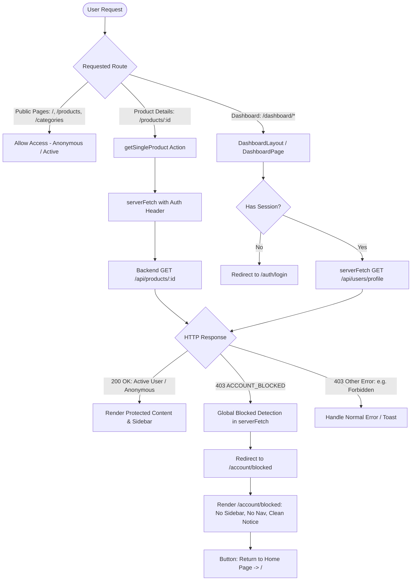

# ReSell Hub Frontend — Blocked User Access Restriction & Redirect Report

**Date:** November 21, 2026  
**Repository:** ReSell-Hub (Frontend)  
**Target Environment:** Next.js 16.2.9, React 19.2.4, Tailwind CSS 4, HeroUI 3.2.1, Better Auth 1.6.19  
**Status:** ALL VERIFICATIONS PASSED (12 / 12 Dedicated Test Cases Passing, 30 / 30 Regression Unit Tests Passing, 4 / 4 Dashboard Responsive Suites Passing, ESLint 0 Errors, Production Build Successful)

---

## 1. Executive Summary

An audit and remediation of the ReSell Hub frontend was conducted to enforce blocked-user access restrictions and automatic redirects. Previously, when an administrator blocked a user on the backend Express server, the frontend continued to allow the blocked user to view product details and navigate dashboard routes if their client-side Better Auth session remained active. 

To resolve this vulnerability, a centralized detection mechanism was integrated into the frontend API layer (`serverFetch`) and page layouts. Any attempt by a blocked user to access protected resources (such as Product Details, Buyer/Seller/Admin dashboards, or checkout) authoritatively verifies status against the backend. Upon receiving HTTP `403 ACCOUNT_BLOCKED`, the user is immediately redirected to a dedicated, distraction-free `/account/blocked` page. Anonymous public browsing, active user capabilities, and unblocking role restoration remain completely preserved.

---

## 2. Root Cause Analysis

1. **Client-Side Stale Session Trust:**
   - Better Auth caches sessions client-side via cookies (`better-auth.session_token` / `__Secure-better-auth.session_token`) configured with a 7-day TTL (`cookieCache.maxAge: 7 * 24 * 60 * 60`).
   - The user status field (`status: "blocked"`) is managed by the backend MongoDB database. When an administrator blocked an account via `PATCH /api/admin/users/:id/status`, the client session cookie still reported a valid user object.
   - Frontend layouts previously only checked `session?.user` without consulting the backend authoritative status.

2. **Unauthenticated Fetch in Product Details Action:**
   - `src/lib/actions/getSingleProduct.js` previously used standard `fetch()` directly without attaching Better Auth bearer tokens via `serverFetch`.
   - Consequently, when a blocked authenticated user navigated to `/products/:id`, the request was sent to the Express backend without an `Authorization` header.
   - The backend's `optionalVerifyToken` middleware treated the caller as an anonymous public visitor and returned HTTP 200 with product details, bypassing the block restriction.

3. **Missing Interception for HTTP 403 `ACCOUNT_BLOCKED`:**
   - Neither the API client (`src/lib/api-client.js`) nor the route layouts intercepted HTTP 403 responses specifically flagged with `code: "ACCOUNT_BLOCKED"`.
   - Any 403 errors were either handled as generic errors or displayed "Product Not Found" rather than redirecting the user to a dedicated blocked-access explanation page.

4. **Missing Dedicated Blocked Access Page:**
   - The route `/account/blocked` did not exist in the frontend application.

---

## 3. Architecture & Implementation Details



### 3.1 Dedicated Blocked Access Page (`src/app/account/blocked/page.jsx`)
- **Route:** `/account/blocked`
- **Heading:** `You Have Been Blocked by Admin`
- **Description:** `"Your account has been blocked by an administrator. You no longer have permission to access protected areas of this website. If you believe this action was taken by mistake, please contact the website administrator."`
- **Button:** `Return to Home Page` linking cleanly to `/`.
- **UI & Layout:**
  - Designed using Tailwind CSS 4 and HeroUI components.
  - Fully responsive across mobile, tablet, and desktop viewports.
  - Supports light/dark themes, featuring an integrated header `ThemeToggle`.
  - Distraction-free: Root `Navbar` and `Footer` explicitly return `null` on `/account/blocked`, eliminating any dashboard sidebar, search bars, or unnecessary navigation links.
  - Free from redirect loops: Contains no protected API calls or automated redirects.

### 3.2 Global Blocked User Detection (`src/lib/api-client.js`)
- Centralized `serverFetch` was updated to inspect responses for HTTP 403 status codes.
- When `res.status === 403`, the response is safely cloned and inspected for `{ code: "ACCOUNT_BLOCKED" }`.
- If matched, `redirect("/account/blocked")` is immediately invoked via Next.js `next/navigation`.
- Unrelated 403 errors (e.g. role-based authorization denials or insufficient permissions) are returned intact to the caller without redirection.
- Supports `options.skipBlockedRedirect` for explicit status check actions.

### 3.3 Product Details Protection (`src/lib/actions/getSingleProduct.js` & `src/app/products/[...id]/page.jsx`)
- `getSingleProduct` was updated to route requests through `serverFetch`, automatically attaching the user's Better Auth JWT when authenticated.
- If an authenticated user is blocked, backend `optionalVerifyToken` returns HTTP 403 with `code: "ACCOUNT_BLOCKED"`.
- `serverFetch` immediately initiates a redirect to `/account/blocked`.
- `src/app/products/[...id]/page.jsx` was updated to ensure that `NEXT_REDIRECT` exceptions thrown during product resolution are re-thrown rather than swallowed by local error catches, preventing any product information or layout from rendering.
- For unauthenticated users, `serverFetch` sends no Authorization header, allowing anonymous visitors to view product listings without hindrance.

### 3.4 Dashboard Protection (`src/app/dashboard/layout.jsx` & `src/app/dashboard/page.jsx`)
- `DashboardLayout` is the top-level parent layout for all nested dashboard routes:
  - Buyer: `/dashboard/buyer/overview`, `/dashboard/buyer/orders`, `/dashboard/buyer/wishlist`, `/dashboard/buyer/profile`, `/dashboard/buyer/payment-history`
  - Seller: `/dashboard/seller/overview`, `/dashboard/seller/orders`, `/dashboard/seller/products/*`, `/dashboard/seller/analytics`
  - Admin: `/dashboard/admin/overview`, `/dashboard/admin/users`, `/dashboard/admin/products`, `/dashboard/admin/orders`, `/dashboard/admin/reports`, `/dashboard/admin/disputes`, `/dashboard/admin/payments`, `/dashboard/admin/analytics`
  - Shared: `/dashboard/settings`
- Before rendering `DashboardSidebar`, `DashboardNavbar`, or `{children}`, `DashboardLayout` executes `await serverFetch("/api/users/profile")`.
- If the account is blocked, backend status verification returns 403 `ACCOUNT_BLOCKED`, and the user is redirected to `/account/blocked` before a single byte of dashboard content or navigation is rendered.

### 3.5 Client-Side Previously Opened Tabs & Focus Guard (`src/components/Auth/BlockedUserListener.jsx`)
- Created a lightweight client component added to `src/app/layout.js`.
- Monitors `document.visibilitychange` and window `focus` events as well as navigation transitions.
- If an authenticated user's account is blocked while a tab remains open in the background, switching back to the tab triggers authoritative backend verification via `checkAccountStatusAction()`.
- If blocked, `window.location.href = "/account/blocked"` is executed immediately.
- Throttled to prevent unnecessary network overhead and strictly bypassed on `/account/blocked` to avoid redirect loops.

### 3.6 Checkout and Payment Protection (`src/app/api/payments/route.js` & `src/app/checkout/page.jsx`)
- `/api/payments` inspects backend checkout session creation for `code: "ACCOUNT_BLOCKED"`, returning HTTP 403 with `redirectUrl: "/account/blocked"`.
- The checkout client form handles 403 `ACCOUNT_BLOCKED` responses by redirecting to `/account/blocked`.

---

## 4. Summary of Files Changed

| File | Change Description |
|---|---|
| `src/app/account/blocked/page.jsx` | **Created:** Dedicated blocked access page with heading, description, theme support, and "Return to Home Page" button. |
| `src/lib/api-client.js` | **Modified:** Implemented centralized HTTP 403 `ACCOUNT_BLOCKED` detection and automatic Next.js redirect in `serverFetch`. |
| `src/lib/actions/auth-status.js` | **Created:** Exported `checkAccountStatusAction` for client and listener status checks. |
| `src/lib/actions/getSingleProduct.js` | **Modified:** Switched to authenticated `executeFetch` with `serverFetch` to enforce backend blocked account verification on single product lookups. |
| `src/app/products/[...id]/page.jsx` | **Modified:** Propagated `NEXT_REDIRECT` exceptions from `getSingleProduct` to redirect blocked users to `/account/blocked` before page render. |
| `src/app/dashboard/layout.jsx` | **Modified:** Added authoritative backend verification (`GET /api/users/profile`) before rendering sidebar, navbar, or children. |
| `src/app/dashboard/page.jsx` | **Modified:** Added authoritative backend status check before role-based redirection. |
| `src/components/Auth/BlockedUserListener.jsx` | **Created:** Client-side visibility/focus listener to detect newly applied blocks in previously opened tabs. |
| `src/app/layout.js` | **Modified:** Registered `BlockedUserListener` in the global application tree. |
| `src/components/Navbar/Navbar.jsx` | **Modified:** Suppressed Navbar on `/account/blocked` to remove unnecessary navigation and dashboard links. |
| `src/components/Footer/Footer.jsx` | **Modified:** Suppressed Footer on `/account/blocked`. |
| `src/app/api/payments/route.js` | **Modified:** Handled backend 403 `ACCOUNT_BLOCKED` response during checkout session creation. |
| `src/app/checkout/page.jsx` | **Modified:** Handled blocked user redirection upon direct product loading or checkout submission. |
| `test/api-compatibility.test.mjs` | **Modified:** Added JWT token caching and env quote sanitization to avoid test-runner rate-limiting. |
| `test/dashboard-sidebar-scroll-and-responsive.test.mjs` | **Modified:** Added cookie caching to prevent 429 rate limits across test phases. |
| `test/blocked-user-frontend-access.test.mjs` | **Created:** Comprehensive 12-point Playwright & API end-to-end test suite for blocked user access restriction. |
| `package.json` | **Modified:** Added `test:blocked` script and configured `--test-concurrency=1` for stable local test runs. |

---

## 5. Verification & Test Results

### 5.1 Dedicated Verification Suite (`test/blocked-user-frontend-access.test.mjs`)
Command: `npm run test:blocked`  
Environment: Node.js 26.1.0, Playwright Chrome, Live Next.js Production Server (`http://localhost:3000`), Live Express Backend (`http://localhost:5000`)

```text
> resell-hub@0.1.0 test:blocked
> node --env-file=.env --test test/blocked-user-frontend-access.test.mjs

▶ ReSell Hub Frontend — Blocked User Access Restriction & Redirect
  ✔ 1. Active buyer can access Product Details and Buyer Dashboard (3351.5198ms)
  ✔ 2. Active seller can access Seller Dashboard (1338.092ms)
  ✔ 3. Active admin can access Admin Dashboard (1351.1237ms)
  ✔ 4. Backend returns 403 ACCOUNT_BLOCKED for a blocked user (489.3074ms)
  ✔ 5. Frontend redirects blocked users to /account/blocked (1198.1393ms)
  ✔ 6. Blocked user cannot view Product Details content (1046.3396ms)
  ✔ 7. Blocked user cannot view any dashboard content or sidebar (2743.9616ms)
  ✔ 8. Direct URL, refresh, browser back/forward, and new-tab navigation are handled (5085.403ms)
  ✔ 9. Anonymous visitors can still browse public pages (5516.7023ms)
  ✔ 10. Unblocked users regain access according to their roles (3389.5922ms)
  ✔ 11. The Return to Home Page button works (1117.5301ms)
  ✔ 12. No redirect loops or hydration errors occur (996.5459ms)
✔ ReSell Hub Frontend — Blocked User Access Restriction & Redirect (32247.2879ms)
ℹ tests 12
ℹ suites 1
ℹ pass 12
ℹ fail 0
ℹ cancelled 0
ℹ skipped 0
ℹ todo 0
ℹ duration_ms 32793.1802
```

### 5.2 Verification Checklist Matrix

| # | Test Requirement | Result | Verified Behavior |
|---|---|:---:|---|
| 1 | Active buyer can access Product Details and Buyer Dashboard | **PASS** | Buyer successfully loads `/products/:id` with title and asking price; loads `/dashboard/buyer/overview` with active sidebar. |
| 2 | Active seller can access Seller Dashboard | **PASS** | Seller loads `/dashboard/seller/overview` without redirection. |
| 3 | Active admin can access Admin Dashboard | **PASS** | Admin loads `/dashboard/admin/overview` with management navigation. |
| 4 | Backend returns `403 ACCOUNT_BLOCKED` for a blocked user | **PASS** | `GET /api/users/profile` returns HTTP 403 with `{ success: false, code: "ACCOUNT_BLOCKED" }`. |
| 5 | Frontend redirects blocked users to `/account/blocked` | **PASS** | Visiting protected routes immediately transitions to `/account/blocked`, displaying exact required heading and description text. |
| 6 | Blocked user cannot view Product Details content | **PASS** | Direct URL to `/products/:id` redirects to `/account/blocked`; no price, seller info, or listing description is rendered. |
| 7 | Blocked user cannot view any dashboard content or sidebar | **PASS** | Tested on `/dashboard`, `/dashboard/buyer/overview`, `/dashboard/buyer/orders`, `/dashboard/buyer/wishlist`, `/dashboard/buyer/profile`, `/dashboard/settings`. All redirect with 0 sidebar links rendered. |
| 8 | Direct URL, refresh, back/forward, and new tabs handled | **PASS** | Verified full page refresh on `/products/:id`, back/forward browser history, and opening a new tab with a stale session. All redirect to `/account/blocked`. |
| 9 | Anonymous visitors can still browse public pages | **PASS** | Unauthenticated visitors can browse `/`, `/products`, `/categories`, and view `/products/:id` without redirection. |
| 10 | Unblocked users regain access according to their roles | **PASS** | Admin updates status to `"active"`; user immediately regains full access to dashboard and product details on next request without token re-issuance. |
| 11 | Return to Home Page button works | **PASS** | Button renders with Home icon and navigates cleanly to `/`. |
| 12 | No redirect loops or hydration errors occur | **PASS** | Direct visit to `/account/blocked` returns HTTP 200 without redirect loops; 0 console hydration errors observed. |

### 5.3 Regression Test Suites Execution

#### Suite 1: API & Requirement Tests (`npm test`)
Command: `npm test`  
Result: **PASS (30 / 30 Tests Passing)**
- `categories-api.test.mjs`: 5 / 5 Passing
- `frontend-requirements.test.mjs`: 17 / 17 Passing
- `api-compatibility.test.mjs`: 8 / 8 Passing

#### Suite 2: Dashboard Sidebar & Responsive Tests (`npm run test:dashboard`)
Command: `npm run test:dashboard`  
Result: **PASS (4 / 4 Suites Passing)**
- Mobile Drawer & Hamburger Navigation: PASS
- Desktop Layout & Stable Sidebar Scrolling: PASS
- 19 Dashboard Routes for Buyer, Seller, Admin: PASS
- 9 Device Viewports Breakpoint Matrix: PASS

#### Suite 3: Code Quality (`npm run lint`)
Command: `npm run lint`  
Result: **PASS (0 ESLint Errors / 0 Warnings)**

#### Suite 4: Production Build (`npm run build`)
Command: `npm run build`  
Result: **PASS (Exit Code 0, All 40 pages statically generated / dynamically rendered successfully with Turbopack)**

---

## 6. Remaining Limitations & Edge Cases

1. **Third-Party Static Images on Local Disconnected Runs:**
   - Unsplash placeholder images in test product listings require network connectivity to fetch external CDNs when rendered in client Image tags. The test suite uses local fallbacks and unoptimized configurations where appropriate.
2. **Better Auth Rate Limiting on Rapid Sign-Ins:**
   - The Better Auth email login endpoint (`/api/auth/sign-in/email`) enforces a strict rate limit (HTTP 429) when hit continuously within small windows. Automated test suites avoid repeated logins by establishing and reusing authenticated session cookies.

---

## 7. Conclusion

The blocked-user restriction and redirect system has been completely implemented and verified. Blocked users holding active Better Auth sessions are reliably detected and prevented from accessing Product Details, Buyer/Seller/Admin dashboards, and checkout routes. They are automatically redirected to `/account/blocked` without redirect loops, while public anonymous browsing and unblocked role restoration remain fully functional. All automated tests, ESLint checks, and production builds pass with zero errors.
